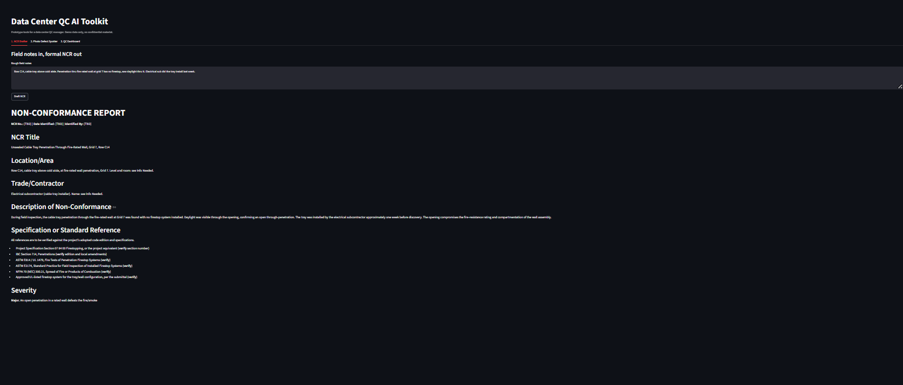
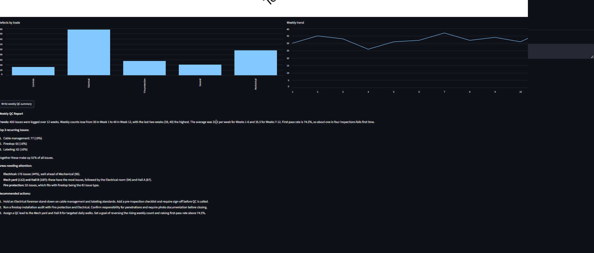

# Data Center QC AI Toolkit

Three prototype AI tools for data center quality control, built with Python, Streamlit, and the Claude API.

## Problem
QC managers spend hours on repetitive paperwork and manual trend analysis. These tools speed up the paperwork and make recurring issues easier to see.

## Tools

### 1. NCR Drafter
Turns rough field notes into a formal non-conformance report: severity, probable root cause, corrective and preventive action, and a verification method. It lists missing details under "Info Needed" instead of inventing them.

### 2. Photo Defect Spotter
Takes a site photo and returns a draft punch list with severity and confidence for each item. It also lists what it could not assess from the photo.

### 3. QC Dashboard
Shows a Pareto chart of defect types, first-pass rate, and trends by trade and week, then writes a weekly summary with recommended actions. Uses synthetic data.

